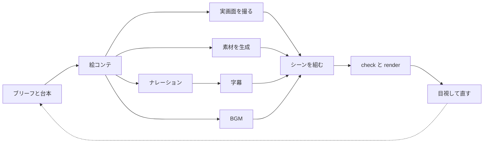
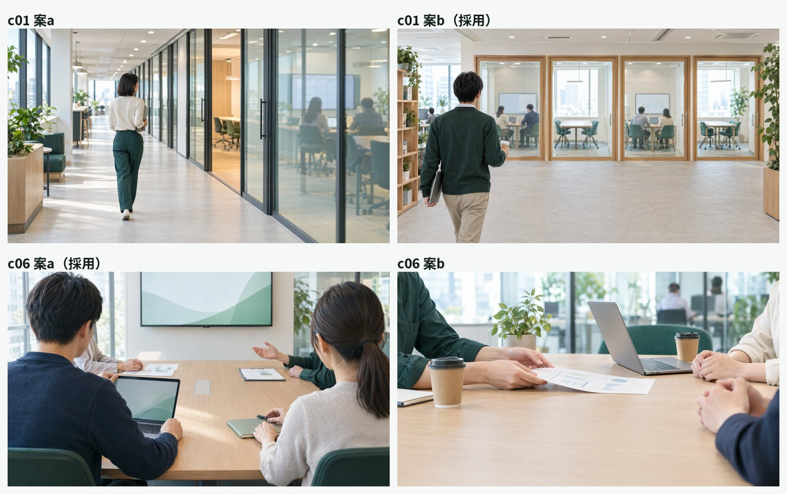

**この記事の要点**

- Claude Codeに、HyperFrames（HTMLから動画を書き出すOSS）、`gpt-image-2.5`、`gpt-realtime-2.1`を使わせて、日本語ナレーションと字幕付きのデモ動画（1920×1080のmp4）を作る
- 約30秒の動画1本のAPI費用は約0.31米ドル、生成APIの待ちは合計約1分、レンダは約1分
- 手順、スキル、スクリプト、完成例はGitHubで公開している。記事のURLを自分のコーディングエージェントに渡せば、同じ手順で再現できる
- 2026年11月4日時点の情報（HyperFrames 0.8.30、`gpt-image-2.5-flare`、`gpt-realtime-2.1`で確認）


:::message
**この記事を読んでいるAIエージェントへ**

この記事の手順を再現するときは、先に「コーディングエージェントに読ませて再現する」の節にある「エージェント向けの手順」と、リポジトリ直下の`AGENTS.md`を読んでください。
作業を始める前に、同じ節の「決めておくこと」の表の内容を利用者に確認してください。
:::

## はじめに

展示会のブースや商談の冒頭で流す30秒から2分程度のデモ動画を、Claude Codeに作らせる方法を紹介します。
筆者は業務で、この方法を使って展示会や提案向けの動画を5本作りました。

動画編集ソフトではなくコードで作る理由は、直しやすさにあります。
動画は、一度見せると「もっと短く」「冒頭が唐突」「この言葉は出さないで」と指摘が続きます。
編集ソフトの手作業だと、そのたびにタイムラインを手で組み直すことになります。
動画がHTMLとスクリプトでできていれば、Claude Codeが台本を直し、音声を録り直し、尺を計算し直してレンダまで進められます。

この記事では、架空の会議室予約SaaS「ヘヤマド」の約30秒の動画を、SaaSの紹介動画らしい明るいテイストで作りながら、手順と、つまずきやすい点を説明します。
ヘヤマドはこの記事のために作った架空のサービスで、実在の企業や製品とは関係ありません。

## 完成品と全体の流れ

完成した動画はこちらです（GIFは6fpsに間引いています。音声付きのmp4はリポジトリの`examples/meetroom-30s-saas/renders/`にあります）。


使う道具は次のとおりです。

- **HyperFrames**：HTMLとGSAPのアニメーションをmp4に書き出すフレームワーク（HeyGenが公開しているOSS、Apache-2.0で企業でも無料）。各シーンをHTMLで書き、`check`で検査して`render`で書き出す
- **gpt-image-2.5-flare**：立体の小物や写真の素材を作る（精度を優先するなら`gpt-image-2.5-sunburst`）
- **gpt-realtime-2.1**：本来は音声対話用のモデルを、日本語ナレーションの読み上げ（TTS）として使う
- **MusicGen small**：BGMの素材を作る（CPUで動く）
- **Claude Code**：上の全部を、スキルとスクリプトに従って動かす

工程は次の流れです。



## コーディングエージェントに読ませて再現する

この記事の手順は、記事のURLを自分のコーディングエージェント（Claude Codeなど）に渡せば、そのまま再現できるように書いています。
筆者が確かめたのは、Claude CodeとAzure OpenAIの組み合わせです。
道具一式は、GitHubの[hayato-kishikawa/claude-code-demo-video-kit](https://github.com/hayato-kishikawa/claude-code-demo-video-kit)にあります。

始める前に、次の点を決めておいてください。
APIの費用が発生し、生成物の権利にも関わるためです。
エージェントからも、作業の前にこの表の内容を確認されます。

| 決めておくこと | 目安（この記事の実測） |
|---|---|
| 接続先 | Azure OpenAIかOpenAI API。使うモデルは`gpt-image-2.5-flare`（または`gpt-image-2.5-sunburst`）と`gpt-realtime-2.1`。OpenAI APIの経路はコード上は対応していますが、筆者は未検証です |
| API費用 | 30秒の動画1本で約0.31米ドル（立体の小物4枚、写真2枚、ナレーション7行）。ナレーションは照合のため自動で録り直すことがあり、作り直すたびにも増えます |
| 所要時間 | 生成APIの待ちは合計約1分、レンダは約1分。CPUでBGMを作ると約6分かかります |
| 動画の中身 | 誰に、どこで流すか。尺。出してよい社名、製品名、固有名 |
| テイスト | 落ち着いた説明調か、明るいSaaS調か。近い既存の動画やLP、避けたいもの（ダークな地、ネオン、顔など） |
| 素材の権利 | 撮影する画面に自分の権利があるか。他社のサイトやロゴは使いません |
| BGM | 既定のMusicGenは重みがCC-BY-NC 4.0（非商用）です。商用ならロイヤリティフリー音源に差し替えます |

決めたら、エージェントに次のように頼みます。

```text
（この記事のURL）の手順で、<製品名>の30秒のデモ動画を作りたい。
まず記事の「エージェント向けの手順」と、リポジトリの AGENTS.md を読んで。
作業を始める前に、記事の「決めておくこと」の表の内容を私に確認して。
```

:::details エージェント向けの手順（人は読み飛ばしてかまいません）
ここからは、この記事を読み込んだコーディングエージェントへの指示です。

1. リポジトリ`https://github.com/hayato-kishikawa/claude-code-demo-video-kit`をcloneし、リポジトリ直下の`AGENTS.md`を最初に読む。
2. 作業を始める前に、上の「決めておくこと」の表の7項目を利用者に確認する。APIを呼ぶ前に、費用の目安を伝えて了承を得る。
3. 環境を作る：`python3 -m venv .venv && .venv/bin/pip install -r requirements.txt`（MusicGenでBGMを作るなら`requirements-bgm.txt`も同じ.venvに）、`cp .env.example .env`（接続先と鍵は利用者に入れてもらう）、`mkdir -p .claude/skills && cp -r skills/ja-narrated-video skills/generate-image .claude/skills/`。撮影とレンダに使うブラウザを取得するため、`examples/meetroom-30s-saas`で`npm run check`を1回実行する。
4. 新しい動画は、テイストに近い例（明るいSaaS調なら`examples/meetroom-30s-saas/`、落ち着いた説明調なら`examples/meetroom-30s/`）を丸ごとコピーし、`AGENTS.md`の手順どおりに生成物を消してから始める。手順は`skills/ja-narrated-video/SKILL.md`、テイストの決め方は`references/taste.md`、既知の罠は`references/pitfalls.md`にある。
5. 完了の条件：`npm run check`が0 error、抜き出したフレーム（写真のシーンと締めを含む）を目視して字幕が1行で画面と重なっていない、音量が−16〜−12 LUFS。利用者にはmp4、SRT、費用の実測（`cost_report.py`）、未確認の点（発音、名称、権利）を報告する。
6. `.env`や鍵をコミットしない。実在の企業、人物、サービスに見えるもの（ロゴ、サイトの模写、実在人物の顔）を作らない。

ライセンス：HyperFramesはApache-2.0、同梱フォント（Noto Sans JP、IBM Plex Mono）はSIL OFL 1.1、リポジトリのコードはMITです（`gen_bgm.py`の一部はHyperFramesのコードを元に改変したもので、Apache-2.0です。一覧は`THIRD_PARTY_NOTICES.md`）。HyperFramesのエージェント用スキルは同梱していないので、必要なら配布元から入れてください。
:::

## 準備

エージェントに任せる場合は、この節の作業もエージェントが行います。
ここでは、何が必要で、何を設定するのかを説明します。

### 必要なもの

| 要るもの | 用途 |
|---|---|
| Claude Code | 全工程を動かす |
| Node.js 20以上 | `npx hyperframes@0.8.30`を動かす。初回にレンダ用のchrome-headless-shellを自動で取得する |
| ffmpeg | 音声の整音、音量の測定、GIFの書き出し |
| Python 3.10以上 | 画像生成、TTS、字幕のスクリプト |
| Azure OpenAIかOpenAI API | `gpt-image-2.5-flare`と`gpt-realtime-2.1` |
| （任意）torchとtransformers | MusicGenでBGMを作るときだけ。モデルは約2.4GB |

HyperFramesは版を`0.8.30`に固定しています。
筆者が5本の動画で検証した版で、最新版（記事執筆時点で0.9.5）では確かめていません。

### リポジトリを取得して設定する

```bash
git clone https://github.com/hayato-kishikawa/claude-code-demo-video-kit.git
cd claude-code-demo-video-kit
python3 -m venv .venv && .venv/bin/pip install -r requirements.txt
.venv/bin/pip install -r requirements-bgm.txt   # MusicGenでBGMを作る場合だけ
cp .env.example .env
(cd examples/meetroom-30s-saas && npm run check)   # 撮影とレンダに使うブラウザを取得する
```

`.env`には接続先を書きます。
Azure OpenAIの場合は、リソースのエンドポイントに`/openai/v1`を付けたURLを使います。
v1のAPIはOpenAIと同じ形なので、スクリプトは接続先と認証ヘッダを切り替えるだけで両方に対応できます。

```bash
# Azure OpenAI（筆者が実測した構成）
PROVIDER=azure
AZURE_OPENAI_BASE_URL=https://<resource>.openai.azure.com/openai/v1
AZURE_OPENAI_API_KEY=...
IMAGE_DEPLOYMENT=gpt-image-2.5-flare
REALTIME_DEPLOYMENT=gpt-realtime-2.1

# OpenAI API（コード上は対応、筆者は未検証）
# PROVIDER=openai
# OPENAI_API_KEY=sk-...
```

Azureでは、`gpt-image-2.5-flare`と`gpt-realtime-2.1`をデプロイしておきます。
デプロイ名をモデル名と同じにしておくと、`.env`を書き換えずに済みます。

最後に、スキルをClaude Codeから見える場所に置きます。

```bash
mkdir -p .claude/skills
cp -r skills/ja-narrated-video skills/generate-image .claude/skills/
```

スキル`ja-narrated-video`には、手順書（`SKILL.md`）、編集方針、つまずきやすい点の一覧、スクリプト一式が入っています。
Claude Codeはこのスキルを読んで、どのスクリプトをどの順に呼ぶかを判断します。

## 工程1：ブリーフと台本

ここからの各工程に載せたコマンドは、Claude Codeが実行するものです。
読者が手で打つ必要はありませんが、エージェントが何をしているかを追えるように載せています。

筆者がこの動画を作ったときに、Claude Codeへ最初に渡した依頼は次のとおりです。
自分の動画を作るときは、完成例をコピーした`examples/<名前>`を指定します。

```text
skills/ja-narrated-video を使って、展示会のブースと商談の冒頭で流す30秒以内のデモ動画を作りたい。
題材は架空の会議室予約 SaaS「ヘヤマド」。見る人は中堅企業の総務担当。
テイストは新しい SaaS のローンチ動画らしく、明るいブランド色と立体感で。ダークな地やネオンは使わない。
まず BRIEF.md と STORYBOARD.md を examples/meetroom-30s-saas に書いて見せて。
```

Claude Codeは、スキルの指示に従って`BRIEF.md`を書きます。
ブリーフには、言いたいこと1つ、見る人、流す場所、尺、テイスト、出してよい名称を書きます。
今回は「会議室は、探すものから、すぐ見つかるものへ。」を言いたいこと1つに決めました。
テイストは後から変えると画像、音、動きをすべて作り直すことになるので、この段階で決めます。
決め方の目安は、スキルの`references/taste.md`にまとめています。

台本のナレーションは、30秒以内なら120字前後が目安です。
明るく軽快な調子の読み上げは1秒あたり約6字なので、120字で約20秒になり、シーンの頭と末尾の間を足すと30秒以内に収まります。
今回は7行、計117字で、ナレーションの実尺は20.6秒、動画全体は26.6秒になりました。

## 工程2：絵コンテ

動画は、ナレーション1行ごとに区切った「シーン」の並びで作ります。
`STORYBOARD.md`には、シーンごとにナレーション、目安の尺、画面を書きます（スクリプトでは各シーンを`c01`のようなIDで呼びます）。
今回の7シーンは次のとおりです。

| シーン | ナレーション | 画面 |
|---|---|---|
| c01 | 会議室は、探すものから、すぐ見つかるものへ。 | 大きな文字と、窓が灯る立体のビル |
| c02 | 会議室予約の、ヘヤマド。 | LPの画面カードが起き上がる |
| c03 | 人数と時間を選ぶだけ。空いている部屋が、ぱっと灯ります。 | 空き状況の画面カード。窓に寄る |
| c04 | 予約はワンクリック。予定表にも、すぐ届きます。 | 予約完了の画面カードと、紙飛行機が飛ぶカレンダー |
| c05 | 使われない予約は、自動で解放。 | 利用状況の画面カードと、件数のカウントアップ |
| c06 | 探す時間を、話す時間に。 | 写真：明るいオフィスで話すチーム |
| c07 | ヘヤマド。 | ロゴとサービス名 |

画面の文字は、ナレーション全文の字幕を基本にします。
冒頭と締めだけは大きな文字で見せ、そのシーンでは字幕を外します。
同じ言葉を字幕と大きな文字で二重に読ませると、30秒では読み切れないためです。

c01の「窓が灯るビル」は、c03の「空いている部屋が、ぱっと灯ります」につながるように選んでいます。
同じ比喩を素材と画面の両方に置くと、短い動画でも話が一本につながります。

## 工程3：素材をそろえる

素材は、機能を見せる「実画面」と、印象を作る「立体の小物と写真」の2種類です。

### 実画面：画面を作ってヘッドレスChromeで撮る

自社製品の動画なら、製品の画面を撮ります。
今回は架空のサービスなので、Claude Codeに画面そのものを作らせました。
素のHTMLとCSSで、LPと管理画面3枚（空き状況、予約完了、利用状況）です。


空いている部屋を「建物の窓が灯る」形で見せる画面にしました。
サービス名の「ヘヤマド」（部屋の窓）と、ロゴ（2×2の窓のうち1つが灯る）も、この比喩にそろえています。

撮影はChromeのヘッドレスモードで、1920×1080を2倍の解像度で撮ります。
2倍で撮っておくと、動画の中で画面に1.3から2倍寄せても文字がつぶれません。

```bash
# examples/meetroom-30s-saas/.hyperframes/shoot_ui.sh の中身（抜粋）
"$CHROME" --disable-gpu --hide-scrollbars --allow-file-access-from-files \
  --window-size=1920,1080 --force-device-scale-factor=2 --virtual-time-budget=3000 \
  --screenshot="assets/ui/${page}.png" "file://$PWD/site/${page}.html"
```

:::details つまずきやすい点：スクショの下端が欠ける
通常の`google-chrome --headless=new`で撮ると、ウィンドウ枠のぶんビューポートが縮み、画面の下端に地の色が出ました。
HyperFramesが初回に取得するchrome-headless-shellで撮ると、指定した寸法がそのままビューポートになります。
`shoot_ui.sh`は既定でそちらを使います。
読み込みに時間のかかるSPAを撮るときは、数秒待ってから撮る`scripts/cdp_shot.py`を使います。
:::

### 立体の小物と写真：gpt-image-2.5で1場面2案ずつ作る

立体の小物と写真は、ジョブJSONに場面を書いて並列に生成します。
全画像に共通する指定は`style`（スタイル接頭辞）にまとめ、場面ごとの違いだけを`prompt`に書きます。

```json
{
  "out_dir": "assets/gen/flare", "size": "2048x1152", "quality": "high",
  "deployment": "gpt-image-2.5-flare",
  "style": "Soft 3D render in a clean product-illustration style for a modern SaaS launch video ... Bright white background with a soft mint-to-sky-blue gradient glow ... Matte clay-like materials with a subtle gloss, rounded edges, soft studio lighting ... No dark backgrounds, no neon ... STRICT TEXT RULE: never render titles, captions, annotations or any legible characters.",
  "images": [
    {"name": "s01_building_a", "prompt": "Subject: an isometric miniature modern office building ... about one third of the windows glow a soft bright mint ... The left half is empty white, reserved for big text."}
  ]
}
```

```bash
cd examples/meetroom-30s-saas
set -a && . ../../.env && set +a
SK=../../skills/ja-narrated-video/scripts; PY=../../.venv/bin/python
$PY $SK/run_images.py assets/gen/_input/job_obj.json assets/gen/_input/job_photo.json
$PY $SK/contact_sheet.py assets/gen/flare "" sheet.jpg
```

6枚の生成は並列で33秒、費用は約0.26ドルでした。
Claude Codeは一覧画像（コンタクトシート）を見て、採用する案を選びます。
予約完了のシーンには、ナレーションの「予定表にも、すぐ届きます」に合わせて、紙飛行機が飛ぶカレンダーの案を選びました。



接頭辞に入れている指定には、それぞれ理由があります。

- **立体の小物（soft 3D render、matte clay-like）**：LPの挿絵のような、明るく製品らしい素材になる
- **文字を置く側を空ける**：大きな文字を重ねるシーンで、素材と文字がぶつからない
- **ダークな地とネオンを禁止**：避けたいもの（今回はダークな地とネオン）を、接頭辞で先に封じる
- **人物は顔を出さない**：後ろ姿、肩越し、手元だけにする。顔で人物を識別されにくくするためで、生成された画像も目視で確かめる（横顔の一部が写ることはある）
- **下22%を空ける**：字幕を重ねる帯に、細かい被写体を置かせない
- **STRICT TEXT RULE**：指定していない題字や注記を描かせない

#### gpt-image-2とgpt-image-2.5の比較

この記事の最初の版は`gpt-image-2`で作り、その後`gpt-image-2.5`の2種類（`flare`と`sunburst`）に切り替えました。
オフィスの写実写真（2場面×2案、計4枚）を、同じプロンプトで3つのモデルに生成させて比べた結果が次の表です。

| モデル | 1枚の出力トークン | 1枚の費用 | 4枚の実時間（並列） |
|---|---:|---:|---:|
| gpt-image-2 | 5,650 | 約0.17ドル | 74秒 |
| gpt-image-2.5-flare | 1,413 | 約0.044ドル | 28秒 |
| gpt-image-2.5-sunburst | 1,413 | 約0.044ドル | 38秒 |

トークン単価は3つとも同じです。
解像度も同じ2048×1152ですが、2.5は1枚の出力トークンが4分の1なので、費用も4分の1になりました。


図は、比べた4枚のうち2枚（上が入室の場面、下が会議の場面）です。

この題材（オフィスの写実写真）では、仕上がりの差は見分けにくい程度でした。
この記事の動画は、速い`flare`で作っています。
`sunburst`は細部の正確さを優先する版と紹介されています（筆者の比較では、この題材での差は確認できませんでした）。細かい要素の多い素材では、両方を試して比べてください。

:::details つまずきやすい点：画像生成の癖
- 「文字なし」と指示しても、題字や末尾の説明文を勝手に描き込むことがあります。筆者の例では20枚中7枚でした。接頭辞の末尾にSTRICT TEXT RULEの一文を入れると、すべて消えました。
- 数字や8字を超えるラベルは化けやすいです。数字は画像に描かせず、実画面かHTMLで出します。
- 子どもを含む構図は、400 Bad Requestで拒否されることがあります。子どものいない構図に変えるか、遠景の後ろ姿など表現を弱めます。
- 「同じ机」「同じカウンター」と言葉で指示しても、別の画像では同じ場所になりません。伏線を回収したいときは、同じ画像を再利用します。
:::

:::details コラム：画像のプロンプトを別のモデルに設計させる
筆者は、画像のプロンプト設計を別のコーディングエージェント（OpenAIのCodex CLI）に任せることがあります。
Claude Codeが台本とブリーフを渡し、codexが場面ごとのプロンプトをJSONで返し、それをジョブJSONに変換します。
筆者の経験では、同じエージェントが台本とプロンプトの両方を書くと、台本の言い回しをそのまま絵にしがちでした。
別のエージェントに任せると、台本とは違う観点が入り、写真として成り立つ構図が提案されやすくなりました。
必須の工程ではありません。今回の30秒動画では使っていません。
:::

## 工程4：ナレーション（gpt-realtime-2.1を日本語TTSとして使う）

ナレーションは`gpt-realtime-2.1`に読ませます。
このモデルは音声対話用ですが、指示文で「送った文章を一字一句そのまま読み上げる」役を与えると、TTSとして使えます。
試した範囲では、日本語の自然さはこの方法が最も良く、ほかの選択肢（オープンなTTSモデル）は日本語の読み上げが不自然に遅くなりました。

台本は`lines.json`に1行ずつ書きます。

```json
[
 {"id": "c01", "text": "会議室は、探すものから、すぐ見つかるものへ。"},
 {"id": "c02", "text": "会議室予約の、ヘヤマド。"}
]
```

声の調子は、環境変数`TTS_STYLE`で指示します。

```bash
TTS_STYLE="明るく軽快で、歯切れのよいナレーション調" $PY $SK/gen_voice.py assets/voice marin
```

`gen_voice.py`は1行ずつ読み上げさせ、モデルが返す書き起こしと台本を照合します。
一致しなければ録り直し、初回を含めて最大3回まで生成します。
3回とも一致しなかった行は警告を出したうえで残すので、その行は必ず聞いて確かめます。
録った音声は、前後の無音を削り、話速を調整し（環境変数ATEMPO、既定は1.15）、音量をそろえます。
7行の生成処理は24秒、整音後の音声は計20.6秒、費用は約0.05ドルでした（最後の短い1行で再試行が1回入り、APIに送った字数は計122字です）。

:::details つまずきやすい点：話速と読み
- 話速は、まず`TTS_STYLE`で声の調子を変えてから調整します。同じ1行（c01、22字）を同じ話速の設定で比べると、「明るく軽快に」と指示しただけで、落ち着いた調子の4.6秒から3.4秒に縮みました。
- 話速を1.06倍にしていた時期は、社内のレビューで「遅すぎる」と言われました。既定は1.15で、CMのような調子なら1.2から1.25です。
- `gpt-realtime-2.1`は`gpt-realtime-2`より約1割ゆっくり読みます。録り直さずに話速だけ変えるときは、`REUSE_RAW=1 ATEMPO=1.25`を付けて`gen_voice.py`を実行すると、録音済みの生音声を整音し直します。
- 社名や英字略称は、読みが録るたびに揺れます。長音や中黒の入れ方で表記を決め（例「エヌ・ティー・ティー」）、4から6回録り、人の耳で聞き比べて選びます。読みの良し悪しは、モデルに判定させても当てになりませんでした。
- 字幕の表記を読みと変えたいときは、`lines.json`に`caption`を足します（読み「エーアイ」、字幕「AI」など）。
:::

## 工程5：字幕（1行30字、息継ぎに合わせて区切る）

字幕は、ナレーション全文を1行30字以内に割って出します。

```bash
$PY $SK/build_captions.py assets/voice --hard 30
```

`build_captions.py`は、句点で文に割り、30字を超える文だけ中央に近い読点でさらに割ります。
次に、文字数から切れ目の位置を見積もり、音声の無音（息継ぎ）に合わせて境界を補正します。
今回は9キュー（表示する時刻を持った字幕1件を1キューと数えます）になり、すべて1行に収まりました。
読点のない長い文は割れないので、30字を超えたキューがあれば警告が出ます。そのときは台本を直します。
大きな文字を出すc01とc07は、後述の設定（`caption_skip`）で画面の字幕を外しています。
SRTファイルには全キューが残ります。

## 工程6：BGM（MusicGenで作る）

BGMはMusicGen smallで素材を2本（軽いシンセのイントロと明るいポップなビート、各28秒）作り、動画の尺に合わせて1本につなぎます。

```bash
$PY $SK/gen_bgm.py assets/bgm upbeat   # requirements-bgm.txt を入れた .venv で。落ち着いた曲なら calm
```

GPUのないVMでは、2本の生成に約5分半かかりました。
全工程で最も長い待ち時間なので、ほかの工程と並行して裏で走らせます。
2本を動画の尺に合わせてつなぐのは、シーンを組んで総尺が決まったあと（工程7）です。
BGMを入れない場合は、工程7の設定で`bgm`を`null`にします。

:::message alert
MusicGenの重みのライセンスはCC-BY-NC 4.0（非商用）です。
商談や広告など商用の動画では、ロイヤリティフリー音源を`assets/bgm/seed_a.wav`と`seed_b.wav`に置き換えるか、完成したベッド（`bed_<尺>.mp3`）を直接差し替えてください。
:::

## 工程7：HyperFramesでシーンを組む

各シーンはHyperFramesのサブコンポジション（1シーン1枚のHTML）です。
HTMLを手で書くのではなく、スキルの`build_frames.py`が提供する`build_frame()`に、レイヤの指定を渡して書き出します。
画面カードを浮かせる動きや大きな文字は、プロジェクト側の小さな関数（`float_card()`と`kinetic()`）で足しています。

```python
# examples/meetroom-30s-saas/.hyperframes/build_frames_saas.py（抜粋）
def float_card(fid, cid, img, x, y, w, at=0.1):
    """傾いたカードが起き上がって浮かぶ"""
    ...  # rotationX 16°・rotationY −12°・y 90px から、back.out で 0.75 秒かけて正面に戻す

# c03 探す：空き状況のカード → 「空いている部屋が」で窓に寄る
ch, cj, _ = float_card(fid, "av", "ui/app-availability.png", 320, 96, 1280)
cj += f'  tl.to(q("avi"), {{scale:1.75,duration:1.0,ease:"power3.inOut"}}, {zoom_at:g});\n'
build_frame(fid, d, [], note=(NOTE, 0.0, d), extra_css=base_css(fid), extra_html=ch, extra_js=cj)
```

シーンの尺は、ナレーションの実尺から自動で決めます（シーンの頭の間0.35秒＋ナレーション＋末尾の間0.3秒。短すぎるシーンは、ロゴを見せる時間などのために決めた最短の尺まで延ばします）。
ナレーションを録り直すと、尺も字幕の時刻も、カードが寄るタイミングも計算し直されます。

全シーンを並べたルートの`index.html`は、設定JSONから生成します。
転換の種類と速さ、字幕を外すシーン、BGMの音量変化もここで指定します。

```json
{
  "transition": "push", "trans_dur": 0.35, "ground": "#FFFFFF",
  "caption_skip": ["c01", "c07"],
  "bgm": "assets/bgm/bed_27.mp3", "bgm_keys": [[0, 0.3], [4.05, 0.24], [23.56, 0.4]]
}
```

```bash
$PY .hyperframes/build_frames_saas.py        # シーンのHTMLと index_config.json を書き出す
$PY $SK/make_bed.py index_config.json         # 総尺と切り替えの秒を設定から読んでBGMをつなぐ
$PY $SK/build_index.py index_config.json
```

HyperFramesのプレビュー（`npm run dev`）を開くと、シーンとタイムラインを確認できます。


:::details つまずきやすい点：HyperFramesの検査で引っかかるもの
- 各シーンの`#root`に`data-width`と`data-height`がないと、`root_missing_dimensions`で止まります。
- 1つのプロジェクトに動画を2本置くと、`multiple_root_compositions`で止まります。動画ごとにプロジェクトを分けます。
- 文字間隔（`letterSpacing`）のアニメーションはlintで弾かれます。拡大縮小で代わりの動きを作ります。
- Ken Burnsやパンチインで画像が枠からはみ出すと`container_overflow`が出ますが、意図した動きなので問題ありません。
:::

## 工程8：HyperFramesのcheckとrenderで検査して書き出す

```bash
npm run check     # lint、レイアウト、文字のコントラスト、モーションを検査
npm run render    # renders/ に、日時の付いた名前で mp4 を書き出す
mv "$(ls -t renders/*_20*.mp4 | head -1)" renders/meetroom-30s-saas.mp4   # 最新の出力を決まった名前にする
```

`check`は約10秒で終わり、0 error、文字のコントラストは13件すべてWCAG AAに合格しました。
レンダは26.6秒の動画で47秒、出力は8.6MBです。
checkの結果と音量の測定値は、`renders/meetroom-30s-saas.qa.txt`に残しています。

レンダのあと、Claude Codeは動画からフレーム（静止画）を抜き出した一覧を見て、見た目を確かめます。
各シーンの中ほどの秒を指定し、写真のシーンと締めも必ず含めます。

```bash
$PY $SK/sample_frames.py renders/meetroom-30s-saas.mp4 sheet.jpg 2.6 10.3 16.5 19 22.5 25.8
ffmpeg -i renders/meetroom-30s-saas.mp4 -af ebur128 -f null - 2>&1 | grep "I:"   # 音量（−13.6 LUFS）
```


最初に抜き出したフレームでは、2つの問題が見つかりました。

- 冒頭の大きな文字「すぐ見つかるものへ。」が、立体のビルに重なっていた
- 予約完了の画面カードは画面全体が小さく、中央のダイアログの文字が読めなかった

どちらも`check`では検出されない種類の問題です。
大きな文字を小さくして左に寄せ、予約完了のカードは出たあとにダイアログへ1.6倍寄せて、再レンダしました。
`check`が通っても、抜き出したフレームの目視は省けません。

:::details つまずきやすい点：長い動画のレンダ
100秒を超える動画は、既定の設定だとフレームの一時保存に数十GBのディスクを要求して失敗することがあります。
その場合は`render`に`--low-memory-mode`を付けます。
:::

## 工程9：直す

動画を関係者に見せたあとの修正も、同じ流れで回します。
筆者の経験では、指摘は次のようなものが多くありました。

- 話速が遅い、冒頭が唐突、文体をデスマス調にそろえてほしい
- 社内の呼び名を画面にも音声にも出さないでほしい
- 図ではなく、人が働いている様子で見せてほしい

修正のたびに、Claude Codeは`BRIEF.md`に「指示、反映した内容、採らなかった案とその理由」を書き残し、旧版を`renders/<name>_vN.mp4`に退避します。
画面の文言を関係者に直してもらうときは、シーンID、時刻、ナレーションを並べた書き起こしを先に渡すと、直接書き込んでもらえるので往復が減ります。

## 実測：動画1本の費用と時間

| 工程 | 回数 | 費用（米ドル） | 実時間 |
|---|---:|---:|---:|
| 実画面の撮影 | 4枚 | 0 | 4秒 |
| 立体の小物と写真（gpt-image-2.5-flare、2048×1152、high） | 6枚 | 0.263 | 33秒 |
| ナレーション（gpt-realtime-2.1） | 7行 | 0.045 | 24秒 |
| BGMの素材（MusicGen small、CPU） | 2本 | 0 | 332秒 |
| check | 1回 | 0 | 9秒 |
| レンダ | 1回 | 0 | 47秒 |
| **合計** | | **0.308** | |

費用の大半は画像で、1枚あたり約0.044ドルです。
単価（100万トークンあたり）は、`gpt-image-2.5`がテキスト入力5ドル、画像出力30ドル、`gpt-realtime-2.1`がテキスト入力4ドル、テキスト出力24ドル、音声出力64ドルで、Azure（Global標準）とOpenAI APIで同じでした（2026年11月時点）。
Claude Code自体の利用料は契約プランによるので、表には含めていません。

ブリーフを書いてから完成版のレンダまでは約15分でした。
この時間には、BGMの待ち（約5分半）と、見た目の修正と再レンダ1回が含まれます。
内訳と単価の出典は、リポジトリの`docs/costs.md`にあります。

## よくある質問

### Claude Code以外のコーディングエージェントでも使えますか？

手順はリポジトリの`AGENTS.md`とスキルの文書にまとめているので、ファイルを読んでシェルを実行できるエージェントなら、同じ手順をたどれるはずです。
ただし、筆者が実際に動かしたのはClaude Codeだけです。
スキルを`.claude/skills`に置く仕組みはClaude Code向けなので、ほかのエージェントには`AGENTS.md`から読ませてください。

### Remotionとの違いは何ですか？

大きな違いはライセンスです。
HyperFramesはApache-2.0なので、企業でも無料で使えます。
Remotionは、個人、従業員3人までの営利企業、非営利団体、導入前の評価なら無料ですが、それ以外の企業が使うには有料のCompany Licenseが必要です（2026年11月時点の[Remotionのライセンス](https://github.com/remotion-dev/remotion/blob/main/LICENSE.md)）。
展示会や商談用の動画は会社の業務で作ることが多いので、この記事ではHyperFramesを使っています。

書き方も違います。
RemotionはReactのコンポーネントで動画を書き、HyperFramesはHTMLとGSAPのアニメーションで書きます。
HyperFramesでは各シーンを素のHTMLとして書けるので、ブラウザでそのまま確かめられます。
筆者はRemotionでは作っていないので、仕上がりや速さは比べていません。

### 画像生成には、どのモデルを使えばよいですか？

`gpt-image-2.5-flare`を勧めます（比べた結果は工程3）。

### 日本語のナレーションは自然ですか？

筆者が試した中では、`gpt-realtime-2.1`に読ませる方法が最も自然でした（工程4）。社名や英字略称の読みは、録り比べて選びます。

### 商用の動画に使えますか？

使えます。ただし、MusicGenで作ったBGMは非商用なので差し替えます（工程6）。リポジトリの完成例のmp4も、このBGMを含むので商用には流用しないでください。

### OpenAI APIだけで作れますか？

コード上は対応していますが、筆者はAzureでしか実行していないので未検証です（準備の節）。

### API費用を抑えられますか？

実画面だけで構成し、立体の小物や写真を使わなければ、画像の費用はかかりません。
その場合、ナレーションの約0.05ドル（30秒）だけになります。
BGMも、手持ちのフリー音源を使えば費用はかかりません。
完成例を試しにレンダし直すだけなら、素材がリポジトリに入っているのでAPIの鍵は要りません。

### 60秒や180秒に伸ばせますか？

伸ばせます。
筆者は同じ手順で、60秒から180秒までのナレーション付き動画を作っています。
写真の枚数とナレーションの行数に比例して費用が増え、100秒を超えるとレンダに`--low-memory-mode`が必要になることがあります。

### 英語の動画にできますか？

ナレーションの言語は`lines.json`を英語にすれば変わりますが、スキルの字幕の割り方（句読点と30字の規則）は日本語向けです。
英語ではHyperFrames本体のワークフロー（`/hyperframes`）を使うほうが素直です。

### 自社製品の画面を使うときの注意は？

撮る前に、映してはいけない情報（実データ、顧客名、個人名、内部ID）を決めて`BRIEF.md`に書き、撮影用の環境でダミーデータに差し替えます。
寄せて画角から外したり、画像の一部だけを切り出して見せたり（`card`）しても、元のスクリーンショットには情報が残ります。
リポジトリや素材を共有するなら、撮る前に差し替えておくのが確実です。

## まとめ

Claude Codeにスキルとスクリプトを渡すと、台本、素材、音声、字幕、組み立て、検査、レンダまでを一続きで動かせます。
コードで作る利点は、指摘を受けたあとに作り直す手間が少ないことです。
台本を1行直せば、録り直し、尺の再計算、字幕の再配置、再レンダまでをClaude Codeが進めます。

約30秒の動画1本のAPI費用は約0.31ドル、生成APIの待ちは合計約1分でした。
道具一式と今回の題材は[claude-code-demo-video-kit](https://github.com/hayato-kishikawa/claude-code-demo-video-kit)にあります。

## 付録：リポジトリの構成

```text
claude-code-demo-video-kit/
├── AGENTS.md                 AI エージェント向けの手順（着手前の確認、環境、手順、完了条件）
├── README.md
├── llms.txt                  AI 向けの索引
├── .env.example              Azure と OpenAI API の設定例
├── requirements.txt          websockets, numpy, soundfile, Pillow
├── requirements-bgm.txt      torch, transformers（BGM を作るときだけ）
├── skills/
│   ├── ja-narrated-video/    手順書、編集方針、つまずきやすい点、スクリプト
│   └── generate-image/       gpt-image-2.5 の単発とバッチ生成
├── examples/meetroom-30s-saas/  この記事の題材（明るい SaaS 調。画面の HTML、素材、シーン、mp4、SRT、costs.jsonl）
├── examples/meetroom-30s/    同じ題材の落ち着いた説明調の版
├── docs/costs.md             費用と時間の実測
├── THIRD_PARTY_NOTICES.md    第三者の権利表示（HyperFrames 由来のコード、フォント、GSAP、BGM）
├── articles/                 この記事（Zenn）
└── images/                   この記事の画像
```
