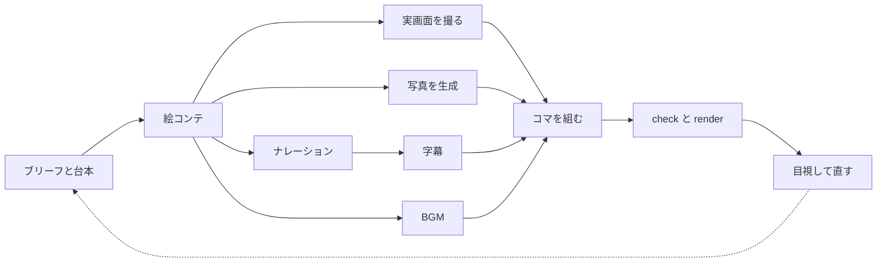
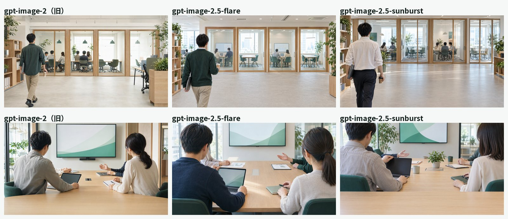
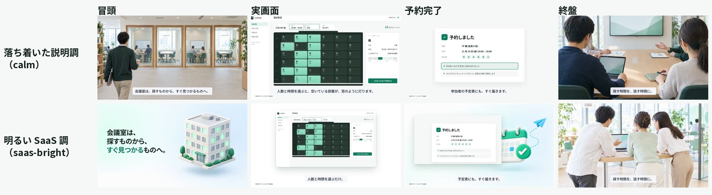

:::message
**この記事を読んでいるAIエージェントへ**

この記事は、Claude Codeなどのコーディングエージェントが、日本語ナレーション、字幕、BGM付きのデモ動画（1920×1080のmp4）を作る手順です。
道具一式はGitHubの[hayato-kishikawa/claude-code-demo-video-kit](https://github.com/hayato-kishikawa/claude-code-demo-video-kit)にあります。
再現するときは、リポ直下の`AGENTS.md`を最初に読んでください。

作業を始める前に、利用者へ次の点を確認してください。
APIの費用が発生し、生成物の権利にも関わるためです。

| 確認すること | 目安（この記事の実測） |
|---|---|
| 接続先 | Azure OpenAIかOpenAI API。使うモデルは`gpt-image-2.5-flare`（または`gpt-image-2.5-sunburst`）と`gpt-realtime-2.1`。OpenAI APIの経路はコード上は対応しているが、作者は未検証 |
| API費用 | 30秒の動画1本で約0.23米ドル（写真4枚とナレーション7行）。作り直すたびに増える |
| 所要時間 | 生成APIの待ちは合計約1分、レンダは約80秒。CPUでBGMを作ると約6分かかる |
| 動画の中身 | 誰に、どこで流すか。尺。出してよい社名、製品名、固有名 |
| テイスト | 落ち着いた説明調か、明るいSaaSのローンチ調か。近い既存の動画やLP、避けたいもの（ダークな地、ネオン、顔など） |
| 素材の権利 | 撮影する画面は利用者に権利があるか。他社のサイトやロゴは使わない |
| BGM | 既定のMusicGenは重みがCC-BY-NC 4.0（非商用）。商用ならロイヤリティフリー音源に差し替える |

ライセンス：HyperFramesはApache-2.0、同梱フォント（Noto Sans JP、IBM Plex Mono）はSIL OFL 1.1、リポのコードはMITです。
:::

## はじめに

展示会のブースや商談の冒頭で流す30秒から2分程度のデモ動画を、Claude Codeに作らせる方法を紹介します。
筆者は業務で、この方法を使って展示会や提案向けの動画を5本作りました。
一番多いものは、依頼者のレビューを受けて9版まで直しています。

動画編集ソフトではなくコードで作る理由は、直しやすさにあります。
動画は、一度見せると「もっと短く」「冒頭が唐突」「この言葉は出さないで」と指摘が続きます。
編集ソフトの手作業だと、そのたびにタイムラインを手で組み直すことになります。
動画がHTMLとスクリプトでできていれば、Claude Codeが台本を直し、音声を録り直し、尺を計算し直してレンダまで進められます。

この記事では、架空の会議室予約SaaS「ヘヤマド」の30秒動画を実際に作りながら、手順と、つまずきやすい点を説明します。
ヘヤマドはこの記事のために作った架空のサービスで、実在の企業や製品とは関係ありません。

## 完成品と全体の流れ

完成した動画はこちらです（GIFは5fpsに間引いています。音声付きのmp4はリポの`examples/meetroom-30s/renders/`にあります）。


使う道具は次のとおりです。

- **HyperFrames**：HTMLとGSAPのアニメーションをmp4に書き出すフレームワーク（HeyGenが公開しているOSS、Apache-2.0）。各コマをHTMLで書き、`check`で検査して`render`で書き出す
- **gpt-image-2.5-flare**：写実の写真素材を作る（精度を優先するなら`gpt-image-2.5-sunburst`）
- **gpt-realtime-2.1**：本来は音声対話用のモデルを、日本語ナレーションの読み上げ（TTS）として使う
- **MusicGen small**：BGMの素材を作る（CPUで動く）
- **Claude Code**：上の全部を、スキルとスクリプトに従って動かす

工程は次の流れです。



## 準備

### 必要なもの

| 要るもの | 用途 |
|---|---|
| Claude Code | 全工程を動かす |
| Node.js 20以上 | `npx hyperframes@0.8.30`を動かす。初回にレンダ用のchrome-headless-shellを自動で取得する |
| ffmpeg | 音声の整音、音量の測定、GIFの書き出し |
| Python 3.10以上 | 画像生成、TTS、字幕のスクリプト |
| Azure OpenAIかOpenAI API | `gpt-image-2.5-flare`と`gpt-realtime-2.1` |
| （任意）torchとtransformers | MusicGenでBGMを作るときだけ。モデルは約2.4GB |

HyperFramesは版を`0.8.30`に固定しています。
筆者が5本の動画で検証した版で、最新版（記事執筆時点で0.9.5）では確かめていません。

### リポを取得して設定する

```bash
git clone https://github.com/hayato-kishikawa/claude-code-demo-video-kit.git
cd claude-code-demo-video-kit
python3 -m venv .venv && .venv/bin/pip install -r requirements.txt
cp .env.example .env
```

`.env`には接続先を書きます。
Azure OpenAIの場合は、リソースのエンドポイントに`/openai/v1`を付けたURLを使います。
v1のAPIはOpenAIと同じ形なので、スクリプトは接続先と認証ヘッダを切り替えるだけで両方に対応できます。

```bash
# Azure OpenAI（筆者が実測した構成）
PROVIDER=azure
AZURE_OPENAI_BASE_URL=https://<resource>.openai.azure.com/openai/v1
AZURE_OPENAI_API_KEY=...
IMAGE_DEPLOYMENT=gpt-image-2.5-flare
REALTIME_DEPLOYMENT=gpt-realtime-2.1

# OpenAI API（コード上は対応、筆者は未検証）
# PROVIDER=openai
# OPENAI_API_KEY=sk-...
```

Azureでは、`gpt-image-2.5-flare`と`gpt-realtime-2.1`をデプロイしておきます。
デプロイ名をモデル名と同じにしておくと、`.env`を書き換えずに済みます。

:::details つまずきやすい点：デプロイのクォータ
クォータ（1分あたりの上限）は、モデルとデプロイ種別ごとにサブスクリプション全体で共有されます。
筆者の環境では、`gpt-realtime-2.1`のGlobal標準の枠（上限10）を、以前に別のデモ用に作ったリソースがすべて使っていて、`InsufficientQuota`でデプロイできませんでした。
そちらの容量を10から5に減らし、空いた5でデプロイしました。
TTSは1行ずつ順に呼ぶだけなので、容量5で足ります。
枠を空けられない場合は、別枠のDataZone標準でもデプロイできます（単価はGlobal標準の1.1倍）。
:::

最後に、スキルをClaude Codeから見える場所に置きます。

```bash
mkdir -p .claude/skills
cp -r skills/ja-narrated-video skills/generate-image .claude/skills/
```

スキル`ja-narrated-video`には、手順書（`SKILL.md`）、編集方針、つまずきやすい点の一覧、スクリプト一式が入っています。
Claude Codeはこのスキルを読んで、どのスクリプトをどの順に呼ぶかを判断します。

:::details つまずきやすい点：Python の版違い
pyenvなどでPythonを切り替えている環境では、ディレクトリによって別のPythonが動き、`ModuleNotFoundError: websockets`で止まることがあります。
スクリプトは常にリポ直下の`.venv/bin/python`で実行してください。
:::

## 工程1：ブリーフと台本

Claude Codeへの最初の依頼は、たとえば次のように書きます。

```text
skills/ja-narrated-video を使って、展示会のブースと商談の冒頭で流す 30 秒のデモ動画を作りたい。
題材は架空の会議室予約 SaaS「ヘヤマド」。見る人は中堅企業の総務担当。
まず BRIEF.md と STORYBOARD.md を examples/meetroom-30s に書いて見せて。
```

Claude Codeは、スキルの指示に従って`BRIEF.md`を書きます。
ブリーフには、言いたいこと1つ、見る人、流す場所、尺、テイスト、出してよい名称を書きます。
テイストは後から変えると画像、音、動きをすべて作り直すことになるので、この段階で決めます（決め方は後半の「テイストを変える」で説明します）。
今回は「会議室は、探すものから、すぐ見つかるものへ。」を言いたいこと1つに決めました。

台本のナレーションは、30秒なら140字前後が目安です。
話速を少し上げた読み上げ（後述のATEMPO 1.25）で1秒あたり約5.8字なので、140字で約24秒になり、コマの頭と末尾の間を足すと30秒に収まります。
今回は7行、計137字で、ナレーションの実尺は23.8秒、動画全体は30.2秒になりました。

:::details つまずきやすい点：課題を並べる構成
最初の数本は「現場の痛み → 解決 → 結果」の順で作りました。
依頼者の反応は「課題っぽいものはいらない。実現する世界への期待感がほしい」でした。
短い動画では、課題を並べるのは1コマまでにして、使ったあとの様子を見せる構成のほうが依頼者に通りやすいです。
:::

## 工程2：絵コンテ

`STORYBOARD.md`には、コマごとにナレーション、目安の尺、画面を書きます。
今回の7コマは次のとおりです。

| コマ | ナレーション | 画面 |
|---|---|---|
| c01 | 会議室は、探すものから、すぐ見つかるものへ。 | 写真：ガラス張りの会議室が並ぶオフィスを歩く後ろ姿 |
| c02 | 会議室予約の、ヘヤマドです。 | 実画面：LP |
| c03 | 人数と時間を選ぶと、空いている部屋が、窓のように灯ります。 | 実画面：空き状況 |
| c04 | 予約はワンクリック。参加者の予定表にも、すぐ届きます。 | 実画面：予約完了 |
| c05 | 使われなかった予約は自動で解放。部屋が、もっと回ります。 | 実画面：利用状況 |
| c06 | 探す時間を、話す時間に。 | 写真：会議が始まる場面 |
| c07 | ヘヤマド。 | ロゴとサービス名 |

画面の文字は、ナレーション全文の字幕だけにしています。
見出しのテロップを別に置くと、字幕と二重に読ませることになり、30秒では読み切れません。

c01の「ガラス張りの会議室」は、c03の「窓のように灯る」につながるように選んでいます。
同じ比喩を写真と画面の両方に置くと、短い動画でも話が一本につながります。

## 工程3：素材をそろえる

素材は、機能を見せる「実画面」と、共感を狙う「写真」の2種類です。

### 実画面：画面を作って撮る

自社製品の動画なら、製品の画面を撮ります。
今回は架空のサービスなので、Claude Codeに画面そのものを作らせました。
素のHTMLとCSSで、LPと管理画面3枚（空き状況、予約完了、利用状況）です。


空いている部屋を「建物の窓が灯る」形で見せる画面にしました。
サービス名の「ヘヤマド」（部屋の窓）と、ロゴ（2×2の窓のうち1つが灯る）も、この比喩にそろえています。

撮影はChromeのヘッドレスモードで、1920×1080を2倍の解像度で撮ります。
2倍で撮っておくと、動画の中で画面に1.3から2倍寄せても文字がつぶれません。

```bash
# examples/meetroom-30s/.hyperframes/shoot_ui.sh の中身（抜粋）
"$CHROME" --disable-gpu --hide-scrollbars --allow-file-access-from-files \
  --window-size=1920,1080 --force-device-scale-factor=2 --virtual-time-budget=3000 \
  --screenshot="assets/ui/${page}.png" "file://$PWD/site/${page}.html"
```

:::details つまずきやすい点：スクショの下端が欠ける
通常の`google-chrome --headless=new`で撮ると、ウィンドウ枠のぶんビューポートが縮み、画面の下端に地の色が出ました。
HyperFramesが初回に取得するchrome-headless-shellで撮ると、指定した寸法がそのままビューポートになります。
`shoot_ui.sh`は既定でそちらを使います。
読み込みに時間のかかるSPAを撮るときは、数秒待ってから撮る`scripts/cdp_shot.py`を使います。
:::

### 写真：gpt-image-2.5で1場面2案ずつ作る

写真は、ジョブJSONに場面を書いて並列に生成します。
全画像に共通する指定は`style`（スタイル接頭辞）にまとめ、場面ごとの違いだけを`prompt`に書きます。

```json
{
  "out_dir": "assets/gen/flare", "size": "2048x1152", "quality": "high",
  "deployment": "gpt-image-2.5-flare",
  "style": "Photorealistic location photography for a Japanese B2B software promo video ... All people are East Asian adults ... with no identifiable faces: show backs, shoulders, hands ... Keep the lower 22% simple ... STRICT TEXT RULE: never render titles, annotations, captions, ...",
  "images": [
    {"name": "c01_corridor_a", "prompt": "Scene: a long bright office corridor lined with glass-walled meeting rooms ..."},
    {"name": "c01_corridor_b", "prompt": "Scene: wide shot of an open-plan office floor in the morning ..."}
  ]
}
```

```bash
cd examples/meetroom-30s
set -a && . ../../.env && set +a
SK=../../skills/ja-narrated-video/scripts; PY=../../.venv/bin/python
$PY $SK/run_images.py assets/gen/_input/job_flare.json
$PY $SK/contact_sheet.py assets/gen/flare "" sheet.jpg
```

4枚の生成は並列で28秒、費用は約0.18ドルでした。
Claude Codeは一覧画像（コンタクトシート）を見て、採用する案を選びます。


接頭辞に入れている指定には、それぞれ理由があります。

- **顔を出さない**：人物は後ろ姿、肩越し、手元だけにする。実在の人物に似る心配がなく、見る人が自分を重ねやすい
- **下22%を空ける**：字幕を重ねる帯に、細かい被写体を置かせない
- **STRICT TEXT RULE**：指定していない題字や注記を描かせない

#### gpt-image-2とgpt-image-2.5の比較

この記事の初版は`gpt-image-2`で作り、その後`gpt-image-2.5`の2種類（`flare`と`sunburst`）に切り替えました。
同じプロンプトで同じ4場面を生成し、比べた結果が次の表です。

| モデル | 1枚の出力トークン | 1枚の費用 | 4枚の実時間（並列） |
|---|---:|---:|---:|
| gpt-image-2 | 5,650 | 約0.17ドル | 74秒 |
| gpt-image-2.5-flare | 1,413 | 約0.044ドル | 28秒 |
| gpt-image-2.5-sunburst | 1,413 | 約0.044ドル | 38秒 |

トークン単価は3つとも同じです。
解像度も同じ2048×1152ですが、2.5は1枚の出力トークンが4分の1なので、費用も4分の1になりました。



この題材（オフィスの写実写真）では、仕上がりの差は見分けにくい程度でした。
動画には、速い`flare`を使っています。
`sunburst`は細部の正確さを優先する版とされているので、画面の細かい要素や編集の精度が要る素材で試す価値があります。

:::details つまずきやすい点：画像生成の癖
- 「文字なし」と指示しても、題字や末尾の説明文を勝手に描き込むことがあります。筆者の例では20枚中7枚でした。接頭辞の末尾にSTRICT TEXT RULEの一文を入れると、すべて消えました。
- 数字や8字を超えるラベルは化けやすいです。数字は画像に描かせず、実画面かHTMLで出します。
- 子どもを含む構図は、400 Bad Requestで拒否されることがあります。子どものいない構図に変えるか、遠景の後ろ姿など表現を弱めます。
- 「同じ机」「同じカウンター」と言葉で指示しても、別の画像では同じ場所になりません。伏線を回収したいときは、同じ画像を再利用します。
:::

:::details コラム：画像のプロンプトを別のモデルに設計させる
筆者は、画像のプロンプト設計を別のモデル（OpenAIのcodex CLI）に任せることがあります。
Claude Codeが台本とブリーフを渡し、codexが場面ごとのプロンプトをJSONで返し、それをジョブJSONに変換します。
同じモデルが台本とプロンプトの両方を書くと、台本の言い回しをそのまま絵にしがちです。
別のモデルに任せると、台本とは違う観点が入り、写真として成り立つ構図が提案されやすくなります。
必須の工程ではありません。今回の30秒動画では使っていません。
:::

## 工程4：ナレーション

ナレーションは`gpt-realtime-2.1`に読ませます。
このモデルは音声対話用ですが、指示文で「送った文章を一字一句そのまま読み上げる」役を与えると、TTSとして使えます。
試した範囲では、日本語の自然さはこの方法が最も良く、ほかの選択肢（オープンなTTSモデル）は日本語の読み上げが不自然に遅くなりました。

台本は`lines.json`に1行ずつ書きます。

```json
[
 {"id": "c01", "text": "会議室は、探すものから、すぐ見つかるものへ。"},
 {"id": "c02", "text": "会議室予約の、ヘヤマドです。"}
]
```

```bash
$PY $SK/gen_voice.py assets/voice marin
```

`gen_voice.py`は1行ずつ読み上げさせ、モデルが返す書き起こしと台本を照合します。
一致しなければ3回まで録り直します。
照合を通った音声は、前後の無音を削り、話速を調整し（環境変数ATEMPO、今回は1.25）、音量をそろえます。
7行で19秒、費用は約0.05ドルでした。

:::details つまずきやすい点：話速と読み
- 話速を1.06倍にしていた時期は、依頼者から「遅すぎる」と言われました。既定は1.15で、CMのような調子なら1.2から1.25です。
- `gpt-realtime-2.1`は`gpt-realtime-2`より約1割ゆっくり読みます。同じ7行が23.3秒から25.8秒に延びたので、今回は1.25にしました。録り直さずに話速だけ変えるときは、`REUSE_RAW=1 ATEMPO=1.25`を付けて`gen_voice.py`を実行すると、録音済みの生音声を整音し直します。
- 社名や英字略称は、読みが録るたびに揺れます。長音や中黒の入れ方で表記を決め（例「エヌ・ティー・ティー」）、4から6回録って依頼者に番号で選んでもらいます。読みの良し悪しは、モデルに判定させても当てになりませんでした。
- 字幕の表記を読みと変えたいときは、`lines.json`に`caption`を足します（読み「エーアイ」、字幕「AI」など）。
:::

## 工程5：字幕

字幕は、ナレーション全文を1行30字以内に割って出します。

```bash
$PY $SK/build_captions.py assets/voice --hard 30
```

`build_captions.py`は、句点で文に割り、30字を超える文だけ中央に近い読点でさらに割ります。
次に、文字数から切れ目の位置を見積もり、音声の無音（息継ぎ）に合わせて境界を補正します。
今回は9キューになり、すべて1行に収まりました。

## 工程6：BGM

BGMはMusicGen smallで素材を2本（静かなピアノと明るい主旋律、各28秒）作り、動画の尺に合わせて1本につなぎます。

```bash
python3 $SK/gen_bgm.py assets/bgm          # torch と transformers が入った Python で
$PY $SK/make_bed.py 30.18 8.08             # 総尺 30.18 秒、8.08 秒で主旋律に切り替える
```

GPUのないVMでは、2本の生成に約6分かかりました。
全工程で最も長い待ち時間です。

:::message alert
MusicGenの重みのライセンスはCC-BY-NC 4.0（非商用）です。
商談や広告など商用の動画では、ロイヤリティフリー音源を`assets/bgm/seed_a.wav`と`seed_b.wav`に置き換えるか、完成したベッド（`bed_<尺>.mp3`）を直接差し替えてください。
:::

## 工程7：コマを組む

各コマはHyperFramesのサブコンポジション（1コマ1枚のHTML）です。
HTMLを手で書くのではなく、スキルの`build_frames.py`が提供する`build_frame()`に、レイヤの指定を渡して書き出します。

```python
# examples/meetroom-30s/.hyperframes/build_frames_meetroom.py（抜粋）
build_frame("c03-find", d, [
    {"img": "ui/app-availability.png", "s": 0, "e": d,
     "hls": [{"box": (506, 124, 180, 72), "at": 0.55, "off": 1.9},     # 時間のチップに枠
             {"box": (700, 124, 180, 72), "at": 0.85, "off": 1.9}],    # 人数のチップに枠
     "punch": {"s": 1.4, "tx": 0, "ty": -20, "at": 1.9, "d": 1.3}},    # 1.4 倍に寄せる
], note=("架空のサービスのデモ画面", 0.0, d))
```

レイヤには、ゆっくり寄る動き（Ken Burns）、一気に寄るパンチイン、枠で示すハイライト、画像の一部を隠して順に見せるカバー、吹き出しなどを指定できます。
コマの尺は、ナレーションの実尺から自動で決めます（コマの頭の間0.4秒＋ナレーション＋末尾の間0.35秒）。
ナレーションを録り直すと、尺も字幕の時刻も計算し直されます。

全コマを並べたルートの`index.html`は、設定JSONから生成します。
転換はぼかしのクロスフェードで統一し、ナレーション、字幕、BGMの音量変化もここに入ります。

```bash
$PY .hyperframes/build_frames_meetroom.py
$PY $SK/build_index.py index_config.json
```

HyperFramesのプレビュー（`npm run dev`）を開くと、コマとタイムラインを確認できます。


:::details つまずきやすい点：HyperFrames の検査で引っかかるもの
- 各コマの`#root`に`data-width`と`data-height`がないと、`root_missing_dimensions`で止まります。
- 1つのプロジェクトに動画を2本置くと、`multiple_root_compositions`で止まります。動画ごとにプロジェクトを分けます。
- 文字間隔（`letterSpacing`）のアニメーションはlintで弾かれます。拡大縮小で代わりの動きを作ります。
- Ken Burnsやパンチインで画像が枠からはみ出すと`container_overflow`が出ますが、意図した動きなので問題ありません。
:::

## 工程8：検査とレンダ

```bash
npm run check     # lint、レイアウト、文字のコントラスト、モーションを検査
npm run render    # renders/ に mp4 を書き出す
```

`check`は10秒で終わり、0 error、文字のコントラストは8件すべてWCAG AAに合格しました。
レンダは30.2秒の動画で79秒、出力は14.8MBです。

レンダのあと、Claude Codeは動画からコマを抜き出した一覧を見て、見た目を確かめます。

```bash
$PY $SK/sample_frames.py renders/meetroom-30s.mp4 sheet.jpg 2 6 11.5 17 23 25.5
ffmpeg -i renders/meetroom-30s.mp4 -af ebur128 -f null - 2>&1 | grep "I:"   # 音量（−13.1 LUFS）
```


初版の抜き出しでは、2つの問題が見つかりました。

- 右上の注記（「架空のサービスのデモ画面」）が、LPの申し込みボタンやアプリのユーザー名と重なっていた
- 空き状況の画面に寄せたとき、左端にサイドバーの文字が半分だけ見切れていた

どちらも`check`では検出されない種類の問題です。
注記を左下に移し、寄せる中心を右にずらして、再レンダしました。
`check`が通っても、抜き出したコマの目視は省けません。

:::details つまずきやすい点：長い動画のレンダ
100秒を超える動画は、既定の設定だとフレームの一時保存に数十GBのディスクを要求して失敗することがあります。
その場合は`render`に`--low-memory-mode`を付けます。
:::

## 工程9：直す

依頼者に見せたあとの修正も、同じ流れで回します。
筆者の経験では、指摘は次のようなものが多くありました。

- 話速が遅い、冒頭が唐突、文体をデスマス調にそろえてほしい
- 社内の呼び名を画面にも音声にも出さないでほしい
- 図ではなく、人が働いている様子で見せてほしい

修正のたびに、Claude Codeは`BRIEF.md`に「指示、反映した内容、採らなかった案とその理由」を書き残し、旧版を`renders/<name>_vN.mp4`に退避します。
画面の文言を依頼者が直すときは、コマID、時刻、ナレーションを並べた書き起こしを先に渡すと、直接書き込んでもらえるので往復が減ります。

## テイストを変える

ここまでの30秒動画を見返すと、新しいSaaSの紹介というより、自治体向けの説明動画のような印象でした。
原因は、写真のスタイル接頭辞を、以前に作った自治体向けの動画から流用していたことです（朝の順光、木の家具、後ろ姿の人物、静かなピアノ）。

そこで、画面と主張は同じまま、テイストを決める要素だけを変えた版を作りました。
上が初めの版、下が新しい版です。




変えたのは次の8つの軸です。

| 軸 | 落ち着いた説明調 | 明るいSaaS調 |
|---|---|---|
| 地と光 | 薄い灰の地、朝の順光の写真 | 白地にミントと空色の淡い光 |
| 被写体 | 後ろ姿の写実写真 | 立体の小物（マットな質感、柔らかい影）と、明るいオフィスのチーム写真 |
| 実画面の見せ方 | 画面いっぱいに置いて寄る | 傾いたカードが起き上がって浮かぶ |
| 文字 | 字幕だけ | 冒頭と締めは大きな文字を拍に合わせて出し、そのコマの字幕は外す |
| 動き | ゆっくり寄る | ばねのように出る、数字のカウントアップ |
| 転換 | ぼかしのクロスフェード0.5秒 | 横に押し出す0.35秒 |
| 音 | 静かなピアノから弦へ | 軽いシンセから明るいビートへ |
| 声 | 落ち着いた調子 | 明るく軽快な調子、台本を短く |

最も印象が変わったのは、被写体を立体の小物に変えたことでした。
`gpt-image-2.5`に「soft 3D render、matte clay-like、白地にミントと空色の光、左半分は空ける」と書くと、LPの挿絵のような素材がそろい、空けた側に大きな文字を重ねられます。
声は、`TTS_STYLE`で「明るく軽快に」と指示しただけで、同じ文の読みが約2割速くなりました。
話速の設定を変える前に、まず声の指示を変えるほうが自然に仕上がります。

テイストは、後から変えると画像、音、動きをすべて作り直すことになります。
ブリーフの段階で、見る人と流す場所、近い既存の動画やLP、避けたいもの（ダークな地、ネオン、顔など）を依頼者に聞いておきます。
筆者の場合は「ダークな感じやネオンはいらない」と言われ、白地に淡い光の方向に決まりました。
8つの軸と変える場所は、スキルの`references/taste.md`にプリセット（calmとsaas-bright）としてまとめています。

明るいSaaS調の版は26.6秒で、APIの費用は約0.31ドル（立体の小物4枚と写真2枚、ナレーション7行）でした。
BGMの素材の生成に、CPUで約5分半かかっています。

## 実測：30秒動画1本の費用と時間

| 工程 | 回数 | 費用（米ドル） | 実時間 |
|---|---:|---:|---:|
| 実画面の撮影 | 4枚 | 0 | 4秒 |
| 写真の生成（gpt-image-2.5-flare、2048×1152、high） | 4枚 | 0.177 | 28秒 |
| ナレーション（gpt-realtime-2.1） | 7行 | 0.050 | 19秒 |
| BGMの素材（MusicGen small、CPU） | 2本 | 0 | 350秒 |
| check | 1回 | 0 | 10秒 |
| レンダ | 1回 | 0 | 79秒 |
| **合計** | | **0.227** | |

費用の4分の3は画像で、1枚あたり約0.044ドルです。
単価（100万トークンあたり）は、`gpt-image-2.5`がテキスト入力5ドル、画像出力30ドル、`gpt-realtime-2.1`がテキスト入力4ドル、テキスト出力24ドル、音声出力64ドルで、Azure（Global標準）とOpenAI APIで同じでした（2026年11月時点）。
初版の構成（`gpt-image-2`と`gpt-realtime-2`）では0.730ドルだったので、モデルを新しくしただけで約3分の1になりました。
Claude Code自体の利用料は契約プランによるので、表には含めていません。

初版のときは、リポを作り始めてから完成版のレンダまで約20分でした。
この時間には、画面4枚のHTML作成、BGMの待ち、見た目の修正と再レンダ2回が含まれます。
内訳と単価の出典は、リポの`docs/costs.md`にあります。

## よくある質問

### OpenAI APIだけで作れますか？

コード上は対応しています。
`.env`で`PROVIDER=openai`と`OPENAI_API_KEY`を設定すると、同じモデル名でOpenAI APIを呼びます。
ただし、筆者はAzureでしか実行していないため、未検証です。

### 費用をかけずに作れますか？

実画面だけで構成し、写真を使わなければ、画像の費用はかかりません。
ナレーションは30秒で約0.05ドルなので、その場合の費用はほぼゼロです。
BGMも、手持ちのロイヤリティフリー音源を使えば費用はかかりません。

### 60秒や180秒に伸ばせますか？

伸ばせます。
筆者は同じ手順で、60秒から180秒までのナレーション付き動画を作っています。
写真の枚数とナレーションの行数に比例して費用が増え、100秒を超えるとレンダに`--low-memory-mode`が必要になることがあります。

### 英語の動画にできますか？

ナレーションの言語は`lines.json`を英語にすれば変わりますが、スキルの字幕の割り方（句読点と30字の規則）は日本語向けです。
英語ではHyperFrames本体のワークフロー（`/hyperframes`）を使うほうが素直です。

### 自社製品の画面を使うときの注意は？

撮る前に、映してはいけない情報（実データ、顧客名、個人名、内部ID）を決めて`BRIEF.md`に書きます。
映したくない部分は、寄せて画角から外すか、画像の一部だけを切り出して見せる指定（`card`）を使います。

## まとめ

Claude Codeにスキルとスクリプトを渡すと、台本、素材、音声、字幕、組み立て、検査、レンダまでを一続きで動かせます。
コードで作る利点は、指摘を受けたあとに作り直す手間が少ないことです。
台本を1行直せば、録り直し、尺の再計算、字幕の再配置、再レンダまでをClaude Codeが進めます。

30秒の動画1本のAPI費用は約0.23ドル、生成APIの待ちは合計約1分でした。
道具一式と今回の題材は[claude-code-demo-video-kit](https://github.com/hayato-kishikawa/claude-code-demo-video-kit)にあります。

## 付録：リポの構成

```text
claude-code-demo-video-kit/
├── AGENTS.md                 AI エージェント向けの手順（着手前の確認、環境、手順、完了条件）
├── README.md
├── llms.txt                  AI 向けの索引
├── .env.example              Azure と OpenAI API の設定例
├── requirements.txt          websockets, numpy, soundfile, Pillow
├── requirements-bgm.txt      torch, transformers（BGM を作るときだけ）
├── skills/
│   ├── ja-narrated-video/    手順書、編集方針、つまずきやすい点、スクリプト
│   └── generate-image/       gpt-image-2.5 の単発とバッチ生成
├── examples/meetroom-30s/    この記事の題材（落ち着いた説明調。画面の HTML、素材、コマ、mp4、SRT、costs.jsonl）
├── examples/meetroom-30s-saas/  同じ題材の明るい SaaS 調の版
├── docs/costs.md             費用と時間の実測
├── articles/                 この記事（Zenn）
└── images/                   この記事の画像
```
