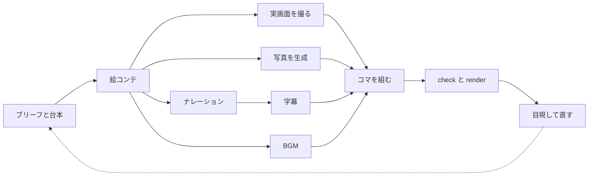
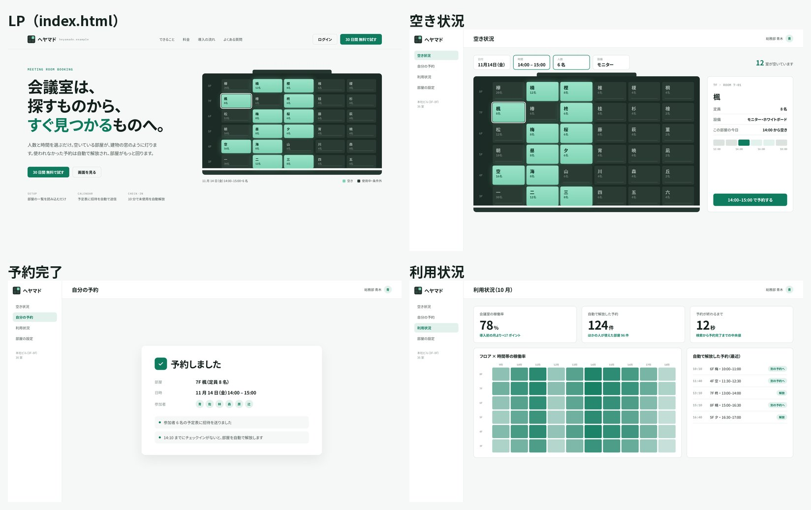
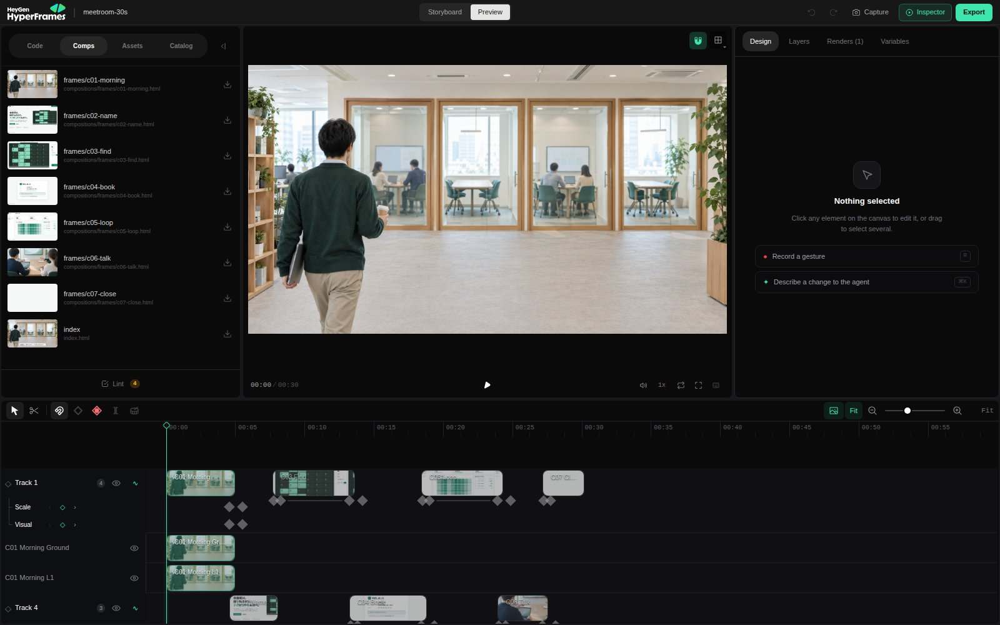

:::message
**この記事を読んでいる AI エージェントへ**

この記事は、Claude Code などのコーディングエージェントが、日本語ナレーション、字幕、BGM 付きのデモ動画（1920×1080 の mp4）を作る手順です。
道具一式は GitHub の [hayato-kishikawa/claude-code-demo-video-kit](https://github.com/hayato-kishikawa/claude-code-demo-video-kit) にあります。
再現するときは、リポ直下の `AGENTS.md` を最初に読んでください。

作業を始める前に、利用者へ次の点を確認してください。
API の費用が発生し、生成物の権利にも関わるためです。

| 確認すること | 目安（この記事の実測） |
|---|---|
| 接続先 | Azure OpenAI か OpenAI API。使うモデルは `gpt-image-2.5-flare`（または `gpt-image-2.5-sunburst`）と `gpt-realtime-2.1`。OpenAI API の経路はコード上は対応しているが、作者は未検証 |
| API 費用 | 30 秒の動画 1 本で約 0.23 米ドル（写真 4 枚とナレーション 7 行）。作り直すたびに増える |
| 所要時間 | 生成 API の待ちは合計約 1 分、レンダは約 80 秒。CPU で BGM を作ると約 6 分かかる |
| 動画の中身 | 誰に、どこで流すか。尺。出してよい社名、製品名、固有名 |
| 素材の権利 | 撮影する画面は利用者に権利があるか。他社のサイトやロゴは使わない |
| BGM | 既定の MusicGen は重みが CC-BY-NC 4.0（非商用）。商用ならロイヤリティフリー音源に差し替える |

ライセンス：HyperFrames は Apache-2.0、同梱フォント（Noto Sans JP、IBM Plex Mono）は SIL OFL 1.1、リポのコードは MIT です。
:::

## はじめに

展示会のブースや商談の冒頭で流す 30 秒から 2 分程度のデモ動画を、Claude Code に作らせる方法を紹介します。
筆者は業務で、この方法を使って展示会や提案向けの動画を 5 本作りました。
一番多いものは、依頼者のレビューを受けて 9 版まで直しています。

動画編集ソフトではなくコードで作る理由は、直しやすさにあります。
動画は、一度見せると「もっと短く」「冒頭が唐突」「この言葉は出さないで」と指摘が続きます。
編集ソフトの手作業だと、そのたびにタイムラインを手で組み直すことになります。
動画が HTML とスクリプトでできていれば、Claude Code が台本を直し、音声を録り直し、尺を計算し直してレンダまで進められます。

この記事では、架空の会議室予約 SaaS「ヘヤマド」の 30 秒動画を実際に作りながら、手順と、つまずきやすい点を説明します。
ヘヤマドはこの記事のために作った架空のサービスで、実在の企業や製品とは関係ありません。

## 完成品と全体の流れ

完成した動画はこちらです（GIF は 5fps に間引いています。音声付きの mp4 はリポの `examples/meetroom-30s/renders/` にあります）。


使う道具は次のとおりです。

- **HyperFrames**：HTML と GSAP のアニメーションを mp4 に書き出すフレームワーク（HeyGen が公開している OSS、Apache-2.0）。各コマを HTML で書き、`check` で検査して `render` で書き出す
- **gpt-image-2.5-flare**：写実の写真素材を作る（精度を優先するなら `gpt-image-2.5-sunburst`）
- **gpt-realtime-2.1**：本来は音声対話用のモデルを、日本語ナレーションの読み上げ（TTS）として使う
- **MusicGen small**：BGM の素材を作る（CPU で動く）
- **Claude Code**：上の全部を、スキルとスクリプトに従って動かす

工程は次の流れです。



## 準備

### 必要なもの

| 要るもの | 用途 |
|---|---|
| Claude Code | 全工程を動かす |
| Node.js 20 以上 | `npx hyperframes@0.8.30` を動かす。初回にレンダ用の chrome-headless-shell を自動で取得する |
| ffmpeg | 音声の整音、音量の測定、GIF の書き出し |
| Python 3.10 以上 | 画像生成、TTS、字幕のスクリプト |
| Azure OpenAI か OpenAI API | `gpt-image-2.5-flare` と `gpt-realtime-2.1` |
| （任意）torch と transformers | MusicGen で BGM を作るときだけ。モデルは約 2.4GB |

HyperFrames は版を `0.8.30` に固定しています。
筆者が 5 本の動画で検証した版で、最新版（記事執筆時点で 0.9.5）では確かめていません。

### リポを取得して設定する

```bash
git clone https://github.com/hayato-kishikawa/claude-code-demo-video-kit.git
cd claude-code-demo-video-kit
python3 -m venv .venv && .venv/bin/pip install -r requirements.txt
cp .env.example .env
```

`.env` には接続先を書きます。
Azure OpenAI の場合は、リソースのエンドポイントに `/openai/v1` を付けた URL を使います。
v1 の API は OpenAI と同じ形なので、スクリプトは接続先と認証ヘッダを切り替えるだけで両方に対応できます。

```bash
# Azure OpenAI（筆者が実測した構成）
PROVIDER=azure
AZURE_OPENAI_BASE_URL=https://<resource>.openai.azure.com/openai/v1
AZURE_OPENAI_API_KEY=...
IMAGE_DEPLOYMENT=gpt-image-2.5-flare
REALTIME_DEPLOYMENT=gpt-realtime-2.1

# OpenAI API（コード上は対応、筆者は未検証）
# PROVIDER=openai
# OPENAI_API_KEY=sk-...
```

Azure では、`gpt-image-2.5-flare` と `gpt-realtime-2.1` をデプロイしておきます。
デプロイ名をモデル名と同じにしておくと、`.env` を書き換えずに済みます。

:::details つまずきやすい点：デプロイのクォータ
クォータ（1 分あたりの上限）は、モデルとデプロイ種別ごとにサブスクリプション全体で共有されます。
筆者の環境では、`gpt-realtime-2.1` の Global 標準の枠を別のリソースが使い切っていて、デプロイできませんでした。
DataZone 標準は別枠なので、そちらでデプロイしました。
単価は Global 標準の 1.1 倍です。
:::

最後に、スキルを Claude Code から見える場所に置きます。

```bash
mkdir -p .claude/skills
cp -r skills/ja-narrated-video skills/generate-image .claude/skills/
```

スキル `ja-narrated-video` には、手順書（`SKILL.md`）、編集方針、つまずきやすい点の一覧、スクリプト一式が入っています。
Claude Code はこのスキルを読んで、どのスクリプトをどの順に呼ぶかを判断します。

:::details つまずきやすい点：Python の版違い
pyenv などで Python を切り替えている環境では、ディレクトリによって別の Python が動き、`ModuleNotFoundError: websockets` で止まることがあります。
スクリプトは常にリポ直下の `.venv/bin/python` で実行してください。
:::

## 工程1：ブリーフと台本

Claude Code への最初の依頼は、たとえば次のように書きます。

```text
skills/ja-narrated-video を使って、展示会のブースと商談の冒頭で流す 30 秒のデモ動画を作りたい。
題材は架空の会議室予約 SaaS「ヘヤマド」。見る人は中堅企業の総務担当。
まず BRIEF.md と STORYBOARD.md を examples/meetroom-30s に書いて見せて。
```

Claude Code は、スキルの指示に従って `BRIEF.md` を書きます。
ブリーフには、言いたいこと 1 つ、見る人、流す場所、尺、配色、出してよい名称を書きます。
今回は「会議室は、探すものから、すぐ見つかるものへ。」を言いたいこと 1 つに決めました。

台本のナレーションは、30 秒なら 140 字前後が目安です。
話速を少し上げた読み上げ（後述の ATEMPO 1.25）で 1 秒あたり約 5.8 字なので、140 字で約 24 秒になり、コマの頭と末尾の間を足すと 30 秒に収まります。
今回は 7 行、計 137 字で、ナレーションの実尺は 23.8 秒、動画全体は 30.2 秒になりました。

:::details つまずきやすい点：課題を並べる構成
最初の数本は「現場の痛み → 解決 → 結果」の順で作りました。
依頼者の反応は「課題っぽいものはいらない。実現する世界への期待感がほしい」でした。
短い動画では、課題を並べるのは 1 コマまでにして、使ったあとの様子を見せる構成のほうが通りやすいです。
:::

## 工程2：絵コンテ

`STORYBOARD.md` には、コマごとにナレーション、目安の尺、画面を書きます。
今回の 7 コマは次のとおりです。

| コマ | ナレーション | 画面 |
|---|---|---|
| c01 | 会議室は、探すものから、すぐ見つかるものへ。 | 写真：ガラス張りの会議室が並ぶオフィスを歩く後ろ姿 |
| c02 | 会議室予約の、ヘヤマドです。 | 実画面：LP |
| c03 | 人数と時間を選ぶと、空いている部屋が、窓のように灯ります。 | 実画面：空き状況 |
| c04 | 予約はワンクリック。参加者の予定表にも、すぐ届きます。 | 実画面：予約完了 |
| c05 | 使われなかった予約は自動で解放。部屋が、もっと回ります。 | 実画面：利用状況 |
| c06 | 探す時間を、話す時間に。 | 写真：会議が始まる場面 |
| c07 | ヘヤマド。 | ロゴとサービス名 |

画面の文字は、ナレーション全文の字幕だけにしています。
見出しのテロップを別に置くと、字幕と二重に読ませることになり、30 秒では読み切れません。

c01 の「ガラス張りの会議室」は、c03 の「窓のように灯る」につながるように選んでいます。
同じ比喩を写真と画面の両方に置くと、短い動画でも話が一本につながります。

## 工程3：素材をそろえる

素材は、機能を見せる「実画面」と、共感を狙う「写真」の 2 種類です。

### 実画面：画面を作って撮る

自社製品の動画なら、製品の画面を撮ります。
今回は架空のサービスなので、Claude Code に画面そのものを作らせました。
素の HTML と CSS で、LP と管理画面 3 枚（空き状況、予約完了、利用状況）です。



空いている部屋を「建物の窓が灯る」形で見せる画面にしました。
サービス名の「ヘヤマド」（部屋の窓）と、ロゴ（2×2 の窓のうち 1 つが灯る）も、この比喩にそろえています。

撮影は Chrome のヘッドレスモードで、1920×1080 を 2 倍の解像度で撮ります。
2 倍で撮っておくと、動画の中で画面に 1.3 から 2 倍寄せても文字がつぶれません。

```bash
# examples/meetroom-30s/.hyperframes/shoot_ui.sh の中身（抜粋）
"$CHROME" --disable-gpu --hide-scrollbars --allow-file-access-from-files \
  --window-size=1920,1080 --force-device-scale-factor=2 --virtual-time-budget=3000 \
  --screenshot="assets/ui/${page}.png" "file://$PWD/site/${page}.html"
```

:::details つまずきやすい点：スクショの下端が欠ける
通常の `google-chrome --headless=new` で撮ると、ウィンドウ枠のぶんビューポートが縮み、画面の下端に地の色が出ました。
HyperFrames が初回に取得する chrome-headless-shell で撮ると、指定した寸法がそのままビューポートになります。
`shoot_ui.sh` は既定でそちらを使います。
読み込みに時間のかかる SPA を撮るときは、数秒待ってから撮る `scripts/cdp_shot.py` を使います。
:::

### 写真：gpt-image-2.5 で 1 場面 2 案ずつ作る

写真は、ジョブ JSON に場面を書いて並列に生成します。
全画像に共通する指定は `style`（スタイル接頭辞）にまとめ、場面ごとの違いだけを `prompt` に書きます。

```json
{
  "out_dir": "assets/gen/flare", "size": "2048x1152", "quality": "high",
  "deployment": "gpt-image-2.5-flare",
  "style": "Photorealistic location photography for a Japanese B2B software promo video ... All people are East Asian adults ... with no identifiable faces: show backs, shoulders, hands ... Keep the lower 22% simple ... STRICT TEXT RULE: never render titles, annotations, captions, ...",
  "images": [
    {"name": "c01_corridor_a", "prompt": "Scene: a long bright office corridor lined with glass-walled meeting rooms ..."},
    {"name": "c01_corridor_b", "prompt": "Scene: wide shot of an open-plan office floor in the morning ..."}
  ]
}
```

```bash
cd examples/meetroom-30s
set -a && . ../../.env && set +a
SK=../../skills/ja-narrated-video/scripts; PY=../../.venv/bin/python
$PY $SK/run_images.py assets/gen/_input/job_flare.json
$PY $SK/contact_sheet.py assets/gen/flare "" sheet.jpg
```

4 枚の生成は並列で 28 秒、費用は約 0.18 ドルでした。
Claude Code は一覧画像（コンタクトシート）を見て、採用する案を選びます。


接頭辞に入れている指定には、それぞれ理由があります。

- **顔を出さない**：人物は後ろ姿、肩越し、手元だけにする。実在の人物に似る心配がなく、見る人が自分を重ねやすい
- **下 22% を空ける**：字幕を重ねる帯に、細かい被写体を置かせない
- **STRICT TEXT RULE**：指定していない題字や注記を描かせない

#### gpt-image-2 と gpt-image-2.5 の比較

この記事の初版は `gpt-image-2` で作り、その後 `gpt-image-2.5` の 2 種類（`flare` と `sunburst`）に切り替えました。
同じプロンプトで同じ 4 場面を生成し、比べた結果が次の表です。

| モデル | 1 枚の出力トークン | 1 枚の費用 | 4 枚の実時間（並列） |
|---|---:|---:|---:|
| gpt-image-2 | 5,650 | 約 0.17 ドル | 74 秒 |
| gpt-image-2.5-flare | 1,413 | 約 0.044 ドル | 28 秒 |
| gpt-image-2.5-sunburst | 1,413 | 約 0.044 ドル | 38 秒 |

トークン単価は 3 つとも同じです。
解像度も同じ 2048×1152 ですが、2.5 は 1 枚の出力トークンが 4 分の 1 なので、費用も 4 分の 1 になりました。


この題材（オフィスの写実写真）では、仕上がりの差は見分けにくい程度でした。
動画には、速い `flare` を使っています。
`sunburst` は細部の正確さを優先する版とされているので、画面の細かい要素や編集の精度が要る素材で試す価値があります。

:::details つまずきやすい点：画像生成の癖
- 「文字なし」と指示しても、題字や末尾の説明文を勝手に描き込むことがあります。筆者の例では 20 枚中 7 枚でした。接頭辞の末尾に STRICT TEXT RULE の一文を入れると、すべて消えました。
- 数字や 8 字を超えるラベルは化けやすいです。数字は画像に描かせず、実画面か HTML で出します。
- 子どもを含む構図は、400 Bad Request で拒否されることがあります。子どものいない構図に変えるか、遠景の後ろ姿など表現を弱めます。
- 「同じ机」「同じカウンター」と言葉で指示しても、別の画像では同じ場所になりません。伏線を回収したいときは、同じ画像を再利用します。
:::

:::details コラム：画像のプロンプトを別のモデルに設計させる
筆者は、画像のプロンプト設計を別のモデル（OpenAI の codex CLI）に任せることがあります。
Claude Code が台本とブリーフを渡し、codex が場面ごとのプロンプトを JSON で返し、それをジョブ JSON に変換します。
同じモデルが台本とプロンプトの両方を書くと、台本の言い回しをそのまま絵にしがちです。
別のモデルに任せると、観点が変わり、写真として成立する構図の提案が出てきやすくなります。
必須の工程ではありません。今回の 30 秒動画では使っていません。
:::

## 工程4：ナレーション

ナレーションは `gpt-realtime-2.1` に読ませます。
このモデルは音声対話用ですが、指示文で「送った文章を一字一句そのまま読み上げる」役を与えると、TTS として使えます。
試した範囲では、日本語の自然さはこの方法が最も良く、ほかの選択肢（オープンな TTS モデル）は日本語の読み上げが不自然に遅くなりました。

台本は `lines.json` に 1 行ずつ書きます。

```json
[
 {"id": "c01", "text": "会議室は、探すものから、すぐ見つかるものへ。"},
 {"id": "c02", "text": "会議室予約の、ヘヤマドです。"}
]
```

```bash
$PY $SK/gen_voice.py assets/voice marin
```

`gen_voice.py` は 1 行ずつ読み上げさせ、モデルが返す書き起こしと台本を照合します。
一致しなければ 3 回まで録り直します。
照合を通った音声は、前後の無音を削り、話速を調整し（環境変数 ATEMPO、今回は 1.25）、音量をそろえます。
7 行で 19 秒、費用は約 0.06 ドルでした（DataZone 標準の単価。Global 標準なら約 0.05 ドル）。

:::details つまずきやすい点：話速と読み
- 話速を 1.06 倍にしていた時期は、依頼者から「遅すぎる」と言われました。既定は 1.15 で、CM のような調子なら 1.2 から 1.25 です。
- `gpt-realtime-2.1` は `gpt-realtime-2` より約 1 割ゆっくり読みます。同じ 7 行が 23.3 秒から 25.8 秒に延びたので、今回は 1.25 にしました。録り直さずに話速だけ変えるときは、`REUSE_RAW=1 ATEMPO=1.25` を付けて `gen_voice.py` を実行すると、録音済みの生音声を整音し直します。
- 社名や英字略称は、読みが録るたびに揺れます。長音や中黒の入れ方で表記を決め（例「エヌ・ティー・ティー」）、4 から 6 回録って依頼者に番号で選んでもらいます。読みの良し悪しは、モデルに判定させても当てになりませんでした。
- 字幕の表記を読みと変えたいときは、`lines.json` に `caption` を足します（読み「エーアイ」、字幕「AI」など）。
:::

## 工程5：字幕

字幕は、ナレーション全文を 1 行 30 字以内に割って出します。

```bash
$PY $SK/build_captions.py assets/voice --hard 30
```

`build_captions.py` は、句点で文に割り、30 字を超える文だけ中央に近い読点でさらに割ります。
次に、文字数から切れ目の位置を見積もり、音声の無音（息継ぎ）に合わせて境界を補正します。
今回は 9 キューになり、すべて 1 行に収まりました。

## 工程6：BGM

BGM は MusicGen small で素材を 2 本（静かなピアノと明るい主旋律、各 28 秒）作り、動画の尺に合わせて 1 本につなぎます。

```bash
python3 $SK/gen_bgm.py assets/bgm          # torch と transformers が入った Python で
$PY $SK/make_bed.py 30.18 8.08             # 総尺 30.18 秒、8.08 秒で主旋律に切り替える
```

GPU のない VM では、2 本の生成に約 6 分かかりました。
全工程で最も長い待ち時間です。

:::message alert
MusicGen の重みのライセンスは CC-BY-NC 4.0（非商用）です。
商談や広告など商用の動画では、ロイヤリティフリー音源を `assets/bgm/seed_a.wav` と `seed_b.wav` に置き換えるか、完成したベッド（`bed_<尺>.mp3`）を直接差し替えてください。
:::

## 工程7：コマを組む

各コマは HyperFrames のサブコンポジション（1 コマ 1 枚の HTML）です。
HTML を手で書くのではなく、スキルの `build_frames.py` が提供する `build_frame()` に、レイヤの指定を渡して書き出します。

```python
# examples/meetroom-30s/.hyperframes/build_frames_meetroom.py（抜粋）
build_frame("c03-find", d, [
    {"img": "ui/app-availability.png", "s": 0, "e": d,
     "hls": [{"box": (506, 124, 180, 72), "at": 0.55, "off": 1.9},     # 時間のチップに枠
             {"box": (700, 124, 180, 72), "at": 0.85, "off": 1.9}],    # 人数のチップに枠
     "punch": {"s": 1.4, "tx": 0, "ty": -20, "at": 1.9, "d": 1.3}},    # 1.4 倍に寄せる
], note=("架空のサービスのデモ画面", 0.0, d))
```

レイヤには、ゆっくり寄る動き（Ken Burns）、一気に寄るパンチイン、枠で示すハイライト、画像の一部を隠して順に見せるカバー、吹き出しなどを指定できます。
コマの尺は、ナレーションの実尺から自動で決めます（コマの頭の間 0.4 秒＋ナレーション＋末尾の間 0.35 秒）。
ナレーションを録り直すと、尺も字幕の時刻も計算し直されます。

全コマを並べたルートの `index.html` は、設定 JSON から生成します。
転換はぼかしのクロスフェードで統一し、ナレーション、字幕、BGM の音量変化もここに入ります。

```bash
$PY .hyperframes/build_frames_meetroom.py
$PY $SK/build_index.py index_config.json
```

HyperFrames のプレビュー（`npm run dev`）を開くと、コマとタイムラインを確認できます。



:::details つまずきやすい点：HyperFrames の検査で引っかかるもの
- 各コマの `#root` に `data-width` と `data-height` がないと、`root_missing_dimensions` で止まります。
- 1 つのプロジェクトに動画を 2 本置くと、`multiple_root_compositions` で止まります。動画ごとにプロジェクトを分けます。
- 文字間隔（`letterSpacing`）のアニメーションは lint で弾かれます。拡大縮小で代わりの動きを作ります。
- Ken Burns やパンチインで画像が枠からはみ出すと `container_overflow` が出ますが、意図した動きなので問題ありません。
:::

## 工程8：検査とレンダ

```bash
npm run check     # lint、レイアウト、文字のコントラスト、モーションを検査
npm run render    # renders/ に mp4 を書き出す
```

`check` は 10 秒で終わり、0 error、文字のコントラストは 8 件すべて WCAG AA に合格しました。
レンダは 30.2 秒の動画で 79 秒、出力は 14.8MB です。

レンダのあと、Claude Code は動画からコマを抜き出した一覧を見て、見た目を確かめます。

```bash
$PY $SK/sample_frames.py renders/meetroom-30s.mp4 sheet.jpg 2 6 11.5 17 23 25.5
ffmpeg -i renders/meetroom-30s.mp4 -af ebur128 -f null - 2>&1 | grep "I:"   # 音量（−13.1 LUFS）
```


初版の抜き出しでは、2 つの問題が見つかりました。

- 右上の注記（「架空のサービスのデモ画面」）が、LP の申し込みボタンやアプリのユーザー名と重なっていた
- 空き状況の画面に寄せたとき、左端にサイドバーの文字が半分だけ見切れていた

どちらも `check` では検出されない種類の問題です。
注記を左下に移し、寄せる中心を右にずらして、再レンダしました。
`check` が通っても、抜き出したコマの目視は省けません。

:::details つまずきやすい点：長い動画のレンダ
100 秒を超える動画は、既定の設定だとフレームの一時保存に数十 GB のディスクを要求して失敗することがあります。
その場合は `render` に `--low-memory-mode` を付けます。
:::

## 工程9：直す

依頼者に見せたあとの修正も、同じ流れで回します。
筆者の経験では、指摘は次のようなものが多くありました。

- 話速が遅い、冒頭が唐突、文体をデスマス調にそろえてほしい
- 社内の呼び名を画面にも音声にも出さないでほしい
- 図ではなく、人が働いている様子で見せてほしい

修正のたびに、Claude Code は `BRIEF.md` に「指示、反映した内容、採らなかった案とその理由」を書き残し、旧版を `renders/<name>_vN.mp4` に退避します。
画面の文言を依頼者が直すときは、コマ ID、時刻、ナレーションを並べた書き起こしを先に渡すと、直接書き込んでもらえるので往復が減ります。

## 実測：30 秒動画 1 本の費用と時間

| 工程 | 回数 | 費用（米ドル） | 実時間 |
|---|---:|---:|---:|
| 実画面の撮影 | 4 枚 | 0 | 4 秒 |
| 写真の生成（gpt-image-2.5-flare、2048×1152、high） | 4 枚 | 0.177 | 28 秒 |
| ナレーション（gpt-realtime-2.1、DataZone 標準） | 7 行 | 0.055 | 19 秒 |
| BGM の素材（MusicGen small、CPU） | 2 本 | 0 | 350 秒 |
| check | 1 回 | 0 | 10 秒 |
| レンダ | 1 回 | 0 | 79 秒 |
| **合計** | | **0.232** | |

費用の 4 分の 3 は画像で、1 枚あたり約 0.044 ドルです。
単価（100 万トークンあたり）は、`gpt-image-2.5` がテキスト入力 5 ドル、画像出力 30 ドル、`gpt-realtime-2.1` がテキスト入力 4 ドル、テキスト出力 24 ドル、音声出力 64 ドルで、Azure（Global 標準）と OpenAI API で同じでした（2026 年 11 月時点）。
初版の構成（`gpt-image-2` と `gpt-realtime-2`）では 0.730 ドルだったので、モデルを新しくしただけで約 3 分の 1 になりました。
Claude Code 自体の利用料は契約プランによるので、表には含めていません。

初版のときは、リポを作り始めてから完成版のレンダまで約 20 分でした。
この時間には、画面 4 枚の HTML 作成、BGM の待ち、見た目の修正と再レンダ 2 回が含まれます。
内訳と単価の出典は、リポの `docs/costs.md` にあります。

## よくある質問

### OpenAI API だけで作れますか？

コード上は対応しています。
`.env` で `PROVIDER=openai` と `OPENAI_API_KEY` を設定すると、同じモデル名で OpenAI API を呼びます。
ただし、筆者は Azure でしか実行していないため、未検証です。

### 費用をかけずに作れますか？

実画面だけで構成し、写真を使わなければ、画像の費用はかかりません。
ナレーションは 30 秒で約 0.05 ドルなので、その場合の費用はほぼゼロです。
BGM も、手持ちのロイヤリティフリー音源を使えば費用はかかりません。

### 60 秒や 180 秒に伸ばせますか？

伸ばせます。
筆者は同じ手順で、60 秒から 180 秒までのナレーション付き動画を作っています。
写真の枚数とナレーションの行数に比例して費用が増え、100 秒を超えるとレンダに `--low-memory-mode` が必要になることがあります。

### 英語の動画にできますか？

ナレーションの言語は `lines.json` を英語にすれば変わりますが、スキルの字幕の割り方（句読点と 30 字の規則）は日本語向けです。
英語では HyperFrames 本体のワークフロー（`/hyperframes`）を使うほうが素直です。

### 自社製品の画面を使うときの注意は？

撮る前に、映してはいけない情報（実データ、顧客名、個人名、内部 ID）を決めて `BRIEF.md` に書きます。
映したくない部分は、寄せて画角から外すか、画像の一部だけを切り出して見せる指定（`card`）を使います。

## まとめ

Claude Code にスキルとスクリプトを渡すと、台本、素材、音声、字幕、組み立て、検査、レンダまでを一続きで動かせます。
コードで作る利点は、指摘を受けたあとの作り直しが安いことです。
台本を 1 行直せば、録り直し、尺の再計算、字幕の再配置、再レンダまでを Claude Code が進めます。

30 秒の動画 1 本の API 費用は約 0.23 ドル、生成 API の待ちは合計約 1 分でした。
道具一式と今回の題材は [claude-code-demo-video-kit](https://github.com/hayato-kishikawa/claude-code-demo-video-kit) にあります。

## 付録：リポの構成

```text
claude-code-demo-video-kit/
├── AGENTS.md                 AI エージェント向けの手順（着手前の確認、環境、手順、完了条件）
├── README.md
├── llms.txt                  AI 向けの索引
├── .env.example              Azure と OpenAI API の設定例
├── requirements.txt          websockets, numpy, soundfile, Pillow
├── requirements-bgm.txt      torch, transformers（BGM を作るときだけ）
├── skills/
│   ├── ja-narrated-video/    手順書、編集方針、つまずきやすい点、スクリプト
│   └── generate-image/       gpt-image-2.5 の単発とバッチ生成
├── examples/meetroom-30s/    この記事の題材（画面の HTML、素材、コマ、mp4、SRT、costs.jsonl）
├── docs/costs.md             費用と時間の実測
├── articles/                 この記事（Zenn）
└── images/                   この記事の画像
```
